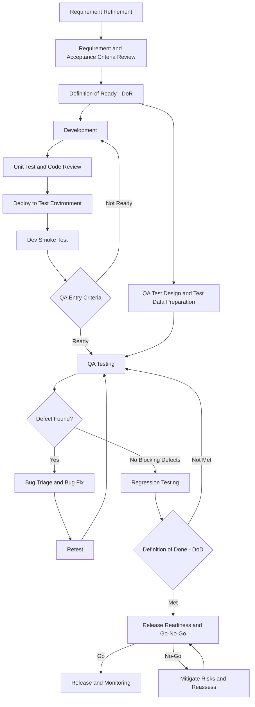

# Scenario 1 — Release Management

## Action 1 — Immediate Response

สิ่งแรกที่แทนจะทำคือประเมินสถานการณ์ก่อนว่า 
ตอนนี้เรามีเวลาเท่าไหร่ มีงานเหลือเท่าไหร่ 
และอะไรคือความเสี่ยงที่สำคัญที่สุดของ Release นี้

แทนจะใช้เวลาประมาณ 15–20 นาที พูดคุยกับทีมเพื่อรวบรวมข้อมูลดังนี้

- Scope ของ Release และฟีเจอร์ที่มีการเปลี่ยนแปลง
- ผลกระทบต่อฟังก์ชันเดิม (Impact Analysis)
- สถานะการทดสอบปัจจุบัน
- Test Case ที่ยังไม่ได้ทดสอบ
- รายละเอียด Bug ทั้ง 5 รายการที่ถูก Reject
- ความพร้อมของ Build, Environment และ Test Data
- ระยะเวลาและจำนวนคนที่สามารถช่วยทดสอบได้
- ความพร้อมของ Rollback Plan

### 1.1 จัดลำดับความสำคัญของการทดสอบ (Risk-based Testing)

ด้วยข้อจำกัดด้านเวลาและจำนวนคน 
แทนจะใช้ Risk-based Testing เข้ามาช่วยจัดลำดับความสำคัญ 
โดยพิจารณาจากความเสี่ยงและผลกระทบต่อลูกค้าและธุรกิจ

| Priority | ความสำคัญ | ขอบเขตการทดสอบ | การดำเนินการ |
|---|---|---|---|
| P0 | Critical | ฟีเจอร์ใหม่ที่เป็นเป้าหมายหลักของ Release, Login, VPN Connection, Payment, Subscription, Security และ Privacy ที่เกี่ยวข้อง | ต้องทดสอบก่อน Release |
| P1 | High | Regression ของฟังก์ชันเดิมที่ได้รับผลกระทบ รวมถึง Device และ OS ที่มีความสำคัญ | ทดสอบหลัง P0 |
| P2 | Medium | ฟังก์ชันรองหรือปัญหาด้าน UI ที่ไม่กระทบการใช้งานหลัก | พิจารณาตามเวลาที่เหลือ |
| P3 | Low | ฟังก์ชันที่มีความเสี่ยงต่ำและไม่ได้รับผลกระทบจากการเปลี่ยนแปลง | สามารถเลื่อนการทดสอบได้ |

Priority ในตารางนี้หมายถึงลำดับความสำคัญของการทดสอบ 
ไม่ใช่ Severity ของ Bug

ขอบเขตการทดสอบจริงจะต้องพิจารณาจาก Requirement 
และ Impact Analysis ของ Release อีกครั้ง

สำหรับ Test Case ที่ไม่ได้ทดสอบ 
แทนจะระบุสถานะเป็น Not Run หรือ Deferred 
พร้อมบันทึกเหตุผลและความเสี่ยงที่เหลืออยู่ 
โดยจะไม่นับรวมเป็น Test Case ที่ผ่าน

### 1.2 การแบ่งงานภายในทีม (Delegation)

ในสถานการณ์นี้ แทนจะลงไปช่วยน้อง QA ทดสอบด้วย 
ไม่ใช่เพียงมอบหมายงานและรอรับรายงานจากน้อง

| Role | Responsibility |
|---|---|
| Head Tester (แทน) | ประเมินความเสี่ยง จัดลำดับงาน ตรวจสอบ Bug ที่ถูก Reject ลงมือทดสอบ Critical Flow ประเมิน Release Readiness ช่วย Execute Test ตามลำดับสำคัญ |
| QA | ทดสอบฟีเจอร์ใหม่แบบ End-to-End และ Regression ตามลำดับความสำคัญ |
| Developer | ตรวจสอบ Unit Test, Smoke Test, วิเคราะห์และแก้ไข Bug รวมถึงช่วยทดสอบในส่วน Technical |
| PO / BA | ยืนยัน Requirement, Expected Behavior และ Business Condition |
| Release Owner | พิจารณาข้อมูลและความเสี่ยงเพื่ออนุมัติการ Release |

สำหรับน้อง QA ที่ลาป่วย แทนจะให้น้องพักรักษาตัว 
และบริหารจัดการงานจากทรัพยากรที่มีอยู่

### 1.3 Hands-on Testing

ส่วนที่แทนจะลงมือช่วยทดสอบด้วยตัวเอง ได้แก่

- ตรวจสอบความพร้อมของ Build ด้วย Smoke Testing
- ทดสอบ Critical Business Flow
- ทดสอบ API ที่เกี่ยวข้องกับฟีเจอร์ใหม่
- ตรวจสอบ Authentication และ Subscription ที่ได้รับผลกระทบ
- ตรวจสอบ Bug ทั้ง 5 รายการร่วมกับ Developer
- วิเคราะห์ Log และตรวจสอบข้อมูลใน Database หากจำเป็นและได้รับสิทธิ์เข้าถึง
- Retest Bug ที่มีความเสี่ยงสูง

เหตุผลที่แทนเลือกช่วยในส่วนนี้ 
เพราะเป็นส่วนที่ต้องใช้ประสบการณ์ในการวิเคราะห์ปัญหา 
และมีผลต่อการตัดสินใจ Release โดยตรง

### 1.4 แผนการดำเนินงานก่อน Release

| ช่วงเวลา | กิจกรรม |
|---|---|
| เย็นวันนี้ | ประเมินสถานการณ์ จัดลำดับงาน และทำ Bug Triage |
| หลัง Bug Triage | ทดสอบ P0 และ P1 ตามความเสี่ยง โดยแบ่งงานทำพร้อมกัน |
| ก่อนจบงานวันนี้ | สรุปผลการทดสอบ Open Defects และความเสี่ยงที่เหลือ |
| พรุ่งนี้ช่วงเช้า | Retest Bug Fix และทดสอบ Impacted Regression |
| ก่อน Release | สรุป Test Result และประชุม Go / No-Go |
| หลัง Release | Production Smoke Test และ Monitoring |

แทนจะกำหนด Cut-off Time สำหรับการรับ Bug Fix 
เพื่อให้ทีมมีเวลาเพียงพอสำหรับ Retest และ Regression Testing 
ก่อนถึงกำหนด Release

### 1.5 Release Decision — Go / No-Go

ก่อน Release แทนจะจัดทำ Test Summary 
เพื่อให้ผู้เกี่ยวข้องเห็นสถานะคุณภาพของระบบตรงกัน

ข้อมูลที่ต้องรายงาน ได้แก่

- Test Execution Status
- Passed / Failed / Blocked / Not Run
- Open Defects และ Severity Defect
- Requirement Coverage
- Risk Coverage
- Known Issues
- Residual Risks ความเสี่ยงที่ยังมีอยู่ก่อน Release นี้ แม้ว่าทีม QA จะดำเนินการทดสอบและจัดการปัญหาไปแล้วก็ตาม
- QA Recommendation

เกณฑ์เบื้องต้นในการให้คำแนะนำสำหรับ Release มีดังนี้

| Decision | Criteria |
|---|---|
| Go | P0 ผ่านครบ ไม่มี Critical Defect ที่กระทบการใช้งานหลัก และความเสี่ยงที่เหลือได้รับการพิจารณาแล้ว |
| Conditional Go | มี Known Issues ที่ไม่กระทบ Critical Flow มีแนวทางลดความเสี่ยง และได้รับการยอมรับจากผู้เกี่ยวข้อง |
| No-Go | Critical Flow ไม่ผ่าน มีความเสี่ยงร้ายแรงด้าน Security, Privacy, Payment หรือยังไม่สามารถยืนยันความพร้อมของฟังก์ชันสำคัญได้ |

แทนเข้าใจว่าฝั่ง Marketing มีข้อจำกัดเรื่องกำหนดการ Release

ทีนี้ การที่บริษัทมีแผน Marketing ไปแล้ว 
ไม่ได้หมายความว่า QA ควรลดมาตรฐานคุณภาพ 
หรือรายงานว่าระบบพร้อมทั้งที่ยังมีความเสี่ยง

หากพบ Critical Issue แทนจะเสนอทางเลือก เช่น

- ปิดเฉพาะฟีเจอร์ที่มีปัญหาด้วย Feature Flag หากระบบรองรับ
- ลด Release Scope หากสามารถทำได้
- เตรียม Rollback Plan
- เสนอให้เลื่อน Release หากไม่สามารถควบคุมความเสี่ยงได้

หน้าที่ของแทนคือการให้ข้อมูลและคำแนะนำด้านคุณภาพอย่างตรงไปตรงมา 
เพื่อให้ผู้มีอำนาจตัดสินใจสามารถตัดสินใจบนพื้นฐานของข้อมูล 
และเข้าใจผลกระทบที่อาจเกิดขึ้น

---

## Action 2 — Conflict Resolution

สำหรับความขัดแย้งระหว่าง QA และ Developer 
แทนจะไม่รีบตัดสินว่าฝ่ายไหนถูกหรือผิด

สิ่งที่ต้องทำก่อนคือหยุดการโต้เถียงในห้องแชท 
แล้วพาทุกคนกลับมาโฟกัสที่ปัญหาและเป้าหมายเดียวกัน

### 2.1 จัด Bug Triage Meeting

แทนจะนัด QA, Developer และ PO/BA 
มาพูดคุยร่วมกันประมาณ 30–45 นาที 
เพื่อทบทวน Bug ทั้ง 5 รายการให้ได้ข้อสรุปภายในเย็นนี้

สิ่งที่ต้องตรวจสอบในแต่ละ Bug ได้แก่

- Steps to Reproduce
- Expected Result
- Actual Result
- Screenshot, Video หรือ Log
- Requirement และ Acceptance Criteria
- Business Condition
- Build Version
- Environment และ Test Data
- ผลกระทบต่อลูกค้าและธุรกิจ

### 2.2 กรณี Developer แจ้งว่า "สเปกไม่ได้เขียนไว้"

แทนจะตรวจสอบ Requirement และ Acceptance Criteria ก่อน

หากไม่มีการระบุไว้จริง 
จะให้ PO/BA หรือผู้รับผิดชอบผลิตภัณฑ์ 
ช่วยยืนยัน Expected Behavior และ Business Condition

เพราะการที่สเปกไม่ได้เขียนไว้ 
ไม่ได้หมายความว่าสิ่งที่ QA พบจะไม่ใช่ Bug เสมอไป

สิ่งที่พบอาจเป็น Requirement Gap 
หรือเป็นพฤติกรรมที่ไม่สอดคล้องกับ Business Condition 
ซึ่งจำเป็นต้องได้รับการพิจารณาก่อน Release

### 2.3 กรณี Developer แจ้งว่า "เครื่อง Dev รันได้ปกติ"

แทนจะให้ QA และ Developer 
ลอง Reproduce ปัญหาร่วมกันบน Environment เดียวกัน

โดยตรวจสอบข้อมูลต่อไปนี้

- Application Version / Build Version
- Environment Configuration
- Device และ OS Version
- Test Data
- User Permission
- Network Configuration
- Application Log และ API Response

เพราะการที่ระบบทำงานได้บนเครื่อง Developer 
ไม่ได้ยืนยันว่าระบบจะทำงานได้เหมือนกันในทุก Environment

### 2.4 สรุปผลการพิจารณา Bug

หลังจากตรวจสอบข้อมูลและพูดคุยร่วมกันแล้ว 
แทนจะแบ่งประเภทของปัญหาตามผลการตรวจสอบ

| Classification | การดำเนินการ |
|---|---|
| Confirmed Defect | Developer แก้ไขตาม Severity และ Priority |
| Requirement Gap | PO/BA ยืนยัน Expected Behavior และอัปเดต Requirement |
| Change Request | ประเมินผลกระทบและวางแผนดำเนินการ |
| Environment / Test Data Issue | ผู้รับผิดชอบตรวจสอบและแก้ไข |
| Need Further Investigation | กำหนด Owner และเวลาที่ต้องได้ข้อสรุป |
| Not a Defect | บันทึกเหตุผลและหลักฐานที่ใช้ประกอบการตัดสินใจ |

Bug ทั้ง 5 รายการจะต้องมีข้อสรุป 
หรืออย่างน้อยต้องมี Owner, Next Action และ Due Time ที่ชัดเจน 
เพื่อให้ทีมสามารถเดินหน้าทำงานต่อได้

หากยังไม่สามารถหาสาเหตุได้ภายในเย็นนี้ 
แทนจะไม่ปิด Bug เพียงเพื่อให้จำนวน Bug ลดลง

### 2.5 การดูแลคนในทีม (People Management)

หลังจากจัดการเรื่อง Bug แล้ว 
แทนจะหาเวลาพูดคุยกับน้อง QA เป็นการส่วนตัว

แทนอยากให้น้องเข้าใจว่า 
การที่ Bug ถูก Reject ไม่ได้หมายความว่าน้องทำงานไม่ดี

เราสามารถนำสิ่งที่เกิดขึ้นมาทบทวนร่วมกันได้ว่า 
Bug Report ของเรามีข้อมูลเพียงพอหรือยัง 
และเราจะสื่อสารกับ Developer ให้เข้าใจกันมากขึ้นได้อย่างไร 

ในขณะเดียวกัน แทนจะพูดคุยกับฝั่ง Developer 
เรื่องการให้ Feedback อย่างสร้างสรรค์ 
โดยใช้ข้อมูลและเหตุผลมากกว่าการโต้เถียงกัน

สำหรับแทน QA และ Developer ไม่ได้อยู่คนละฝ่าย 
ทุกคนมีเป้าหมายเดียวกันคือการส่งมอบผลิตภัณฑ์ที่มีคุณภาพ
เพียงแต่ในช่วงเวลาที่เร่งด่วน เราอาจสื่อสารคนละมุมมอง ทำให้เกิดความรู้สึกที่ไม่ดีต่อกันได้
ดังนั้น แทนอาจจะสอนเรื่องเทคนิค การสื่อสารให้ทั้งสองฝ่าย

---

## Action 3 — Process Improvement

หลังจากผ่าน Release นี้ไปแล้ว 
แทนจะจัด Retrospective ร่วมกับทีม 
เพื่อหาสาเหตุที่ทำให้เกิดปัญหา

แทนจะไม่เริ่มจากการหาว่าใครเป็นคนผิด 
แต่จะดูว่ากระบวนการทำงานตรงไหนที่เราสามารถปรับปรุงได้ 
เพื่อไม่ให้เกิดปัญหาเดิมซ้ำใน Sprint ถัดไป

### 3.1 วิเคราะห์ปัญหาที่เกิดขึ้น

| Problem | สิ่งที่ต้องตรวจสอบ | แนวทางปรับปรุง |
|---|---|---|
| Dev ส่งงานล่าช้า | Estimation, Dependency และการติดตามงาน | กำหนด Handover Plan และ Cut-off Time |
| QA มีเวลาทดสอบไม่เพียงพอ | Sprint Planning และ QA Capacity | วางแผน Testing Effort ตั้งแต่ต้น Sprint |
| Requirement ไม่ชัดเจน | Acceptance Criteria และ Business Condition | ทำ Requirement Review ร่วมกัน |
| Bug ถูก Reject | คุณภาพของ Bug Report และความเข้าใจ Expected Behavior | กำหนด Bug Triage Process |
| QA ขาดคนกะทันหัน | Knowledge Sharing และการกระจายงาน | ทำ Cross-training และ Backup Plan |

### 3.2 ปรับปรุง Workflow ด้วย Shift-left Testing

แทนจะให้ QA เข้ามามีส่วนร่วมตั้งแต่ช่วง Requirement Refinement 
แทนที่จะรอให้ Developer พัฒนางานเสร็จแล้วจึงเริ่มทำงาน

การทำงานลักษณะนี้จะช่วยให้ QA สามารถเตรียม Test Scenario, 
Test Case และ Test Data ได้ตั้งแต่ช่วงที่ Developer กำลังพัฒนา

นอกจากนี้ยังช่วยให้ทีมสามารถค้นพบ Requirement Gap 
และ Business Condition ที่ไม่ชัดเจนได้ตั้งแต่ต้น Sprint 
แทนที่จะมาพบปัญหาในช่วงท้ายก่อน Release

### 3.3 กำหนด Definition of Ready (DoR)

ก่อนนำ User Story เข้า Sprint 
ควรมีข้อมูลที่เพียงพอสำหรับการพัฒนาและทดสอบ

- Requirement ชัดเจน
- Acceptance Criteria สามารถทดสอบได้
- Business Condition ได้รับการยืนยัน
- Dependency และความเสี่ยงได้รับการระบุ
- Developer และ QA เข้าใจ Scope ตรงกัน
- มีการประเมิน Development Effort และ Testing Effort

### 3.4 กำหนด QA Entry Criteria

ก่อน Developer ส่งมอบงานให้ QA 
ควรมีการตรวจสอบความพร้อมเบื้องต้น

| Entry Criteria | Responsibility |
|---|---|
| Requirement และ Acceptance Criteria ได้รับการยืนยัน | PO / BA |
| Business Condition ได้รับการยืนยัน | PO / BA |
| Development ตาม Scope เสร็จเรียบร้อย | Developer |
| Unit Test ผ่านตามเกณฑ์ที่ตกลงกัน | Developer |
| Code Review เรียบร้อย | Developer |
| Deploy Build ไปยัง Test Environment | Developer / DevOps |
| Dev Smoke Test ผ่าน | Developer |
| ระบุ Build Version และ Change List | Developer |
| แจ้ง Known Issues และข้อจำกัด | Developer |
| Test Environment และ Test Data พร้อม | ทีมที่เกี่ยวข้อง |

หากงานยังไม่ผ่าน Entry Criteria 
QA จะต้องแจ้งสถานะและผลกระทบให้ทีมรับทราบ 
เพื่อร่วมกันตัดสินใจว่าจะรับงานเข้าทดสอบหรือปรับแผน

หากจำเป็นต้องรับงานเข้าทดสอบทั้งที่ยังไม่พร้อม 
จะต้องบันทึกข้อจำกัดและความเสี่ยงให้ชัดเจน

### 3.5 กำหนด Handover Plan และ Cut-off Time

ในช่วง Sprint Planning 
แทนจะวางแผนร่วมกับ Developer และ PO 
โดยกำหนดให้มีเวลาสำหรับกิจกรรมต่อไปนี้อย่างชัดเจน

- Development
- QA Testing
- Bug Fixing
- Retesting
- Regression Testing
- Release Preparation

แทนจะสนับสนุนให้ Developer ทยอยส่งมอบงานที่พร้อม 
แทนการส่งงานทั้งหมดในช่วงท้าย Sprint

หากมีแนวโน้มว่าจะส่งงานไม่ทัน 
ต้องแจ้งความเสี่ยงตั้งแต่เนิ่น ๆ 
เพื่อให้ทีมสามารถปรับ Scope หรือแผนการทำงานร่วมกันได้

ไม่ใช่รอจนถึงวันก่อน Release 
แล้วให้ QA เป็นฝ่ายรับภาระทั้งหมด

### 3.6 กำหนด Definition of Done (DoD)

ก่อนปิด User Story หรืออนุมัติ Release 
ควรมีเกณฑ์ด้านคุณภาพที่ทีมเข้าใจตรงกัน ได้แก่

- Acceptance Criteria ผ่านการทดสอบ
- Business Condition ที่เกี่ยวข้องได้รับการทดสอบ
- Critical Test Cases ผ่าน
- Bug ที่ต้องแก้ไขได้รับการ Retest
- Impacted Regression Testing เรียบร้อย
- ไม่มี Critical Defect ที่เป็น Release Blocker
- Known Issues และ Residual Risks ได้รับการบันทึก
- Test Result และ Evidence สามารถตรวจสอบย้อนหลังได้

### 3.7 การติดตามและวัดผล (Quality Metrics)

แทนจะนำ Metrics มาใช้เพื่อดูว่ากระบวนการที่ปรับปรุง 
สามารถช่วยลดปัญหาที่เกิดขึ้นได้จริงหรือไม่

| Metric | สิ่งที่ต้องการวัด |
|---|---|
| On-time Handover Rate | สัดส่วนงานที่ Developer ส่งมอบตรงตามแผน |
| QA Entry Criteria Compliance | ความพร้อมของงานก่อนส่งให้ QA |
| Requirement Coverage | ความครอบคลุมของ Requirement ที่ได้รับการทดสอบ |
| Requirement Gap | จำนวนปัญหาที่เกิดจาก Requirement ไม่ชัดเจน |
| Defect Rejection Rate | สัดส่วน Bug ที่ถูก Reject และสาเหตุ |
| Defect Leakage | Bug ที่หลุดไปยัง Production |
| Regression Execution Time | ระยะเวลาที่ใช้ในการทำ Regression Testing |

แทนจะเก็บ Baseline ก่อนกำหนด Target 
เพื่อให้เป้าหมายสอดคล้องกับสถานการณ์จริงของทีม

จากนั้นจะนำข้อมูลมาทบทวนร่วมกันใน Sprint Retrospective 
เพื่อดูว่าแนวทางที่ปรับปรุงไปช่วยแก้ปัญหาได้มากน้อยแค่ไหน 
และยังมีส่วนไหนที่ต้องปรับปรุงเพิ่มเติม

Metrics เหล่านี้ไม่ได้มีไว้เพื่อจับผิดว่าใครทำงานไม่ดี 
แต่มีไว้เพื่อให้ทีมมองเห็นปัญหา 
และปรับปรุงกระบวนการทำงานร่วมกัน

---

## Conclusion

สำหรับสถานการณ์นี้ แทนให้ความสำคัญกับ 3 เรื่อง

### 1. Business & Product Quality

บริหารความเสี่ยงและส่งมอบผลิตภัณฑ์ 
โดยไม่ละเลยคุณภาพและผลกระทบต่อลูกค้า

### 2. People & Collaboration

ดูแลคนในทีม แก้ไขความขัดแย้งด้วยข้อมูลและเหตุผล 
และสร้างความร่วมมือระหว่าง QA กับ Developer

### 3. Continuous Improvement

นำปัญหาที่เกิดขึ้นมาปรับปรุง Workflow 
เพื่อป้องกันไม่ให้เกิดปัญหาเดิมซ้ำ

สำหรับแทน การเป็น Head Tester 
ไม่ใช่เพียงการแก้ปัญหาเฉพาะหน้าให้ผ่านไปได้

สิ่งที่สำคัญไม่แพ้กันคือ 
การทำให้ทีมเรียนรู้จากปัญหาที่เกิดขึ้น 
และมีกระบวนการทำงานที่ดีขึ้นใน Sprint ถัดไปค่ะ
