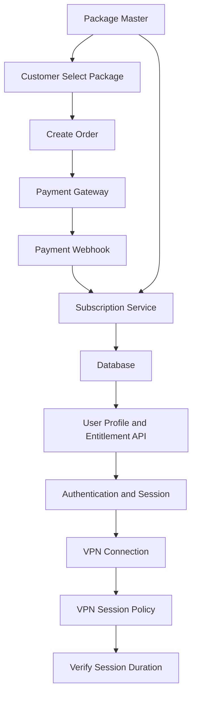

# Scenario 2 — Hands-on Investigation & Root Cause Analysis

## 1. Initial Investigation

ในสถานการณ์นี้ แทนจะไม่รอให้ Developer ประชุมเสร็จ แต่จะเริ่มลงมือตรวจสอบปัญหาด้วยตัวเองก่อน

เนื่องจากเป็นปัญหาที่เกิดขึ้นบน Production และส่งผลกระทบโดยตรงต่อลูกค้าที่ชำระเงินแล้ว

สิ่งแรกที่แทนจะทำคือรวบรวมข้อมูลจาก Customer Support และประเมินผลกระทบว่าเป็นปัญหาที่เกิดขึ้นกับลูกค้ารายเดียว หรือมีลูกค้ารายอื่นได้รับผลกระทบด้วย

### 1.1 ข้อมูลที่ต้องรวบรวม

| Data | Purpose |
|---|---|
| User ID | ตรวจสอบบัญชีของลูกค้า |
| Order ID | ตรวจสอบรายการสั่งซื้อ |
| Transaction ID | ตรวจสอบรายการชำระเงิน |
| Package ID | ตรวจสอบแพ็กเกจที่ลูกค้าเลือกซื้อ |
| Package Name | ตรวจสอบชื่อแพ็กเกจว่าถูกต้องหรือมีการสลับชื่อ |
| Package Type | ตรวจสอบประเภท Free หรือ Premium |
| Package Price | ตรวจสอบราคาแพ็กเกจ ณ เวลาที่สั่งซื้อ |
| Package Entitlement | ตรวจสอบสิทธิ์การใช้งาน |
| Subscription ID | ตรวจสอบสถานะและระยะเวลาการใช้งาน |
| Session ID | ตรวจสอบ VPN Session |
| Correlation ID / Request ID | ติดตาม Request ระหว่าง Service |
| Payment Date & Time | ตรวจสอบลำดับเหตุการณ์การชำระเงิน |
| Application Version | ตรวจสอบเวอร์ชันที่เกิดปัญหา |
| Device / OS | ตรวจสอบความแตกต่างของอุปกรณ์ |
| Incident Date & Time | ค้นหา Log ในช่วงเวลาที่เกิดปัญหา |

### 1.2 Impact Assessment

- ตรวจสอบจำนวนลูกค้าที่ได้รับผลกระทบ
- ตรวจสอบว่าเกิดกับ Premium Package ทุกประเภทหรือเฉพาะบาง Package
- ตรวจสอบว่าเกิดกับลูกค้าใหม่หรือลูกค้าเดิมที่ Upgrade Package
- ตรวจสอบว่าเกิดขึ้นหลังจาก Release ล่าสุดหรือไม่
- ตรวจสอบว่ามี Incident ลักษณะเดียวกันก่อนหน้านี้หรือไม่
- ประเมินผลกระทบต่อ Customer Experience และ Business

แทนจะประสาน Customer Support ให้แจ้งลูกค้าว่าทีมกำลังตรวจสอบปัญหา พร้อมกำหนดรอบการอัปเดตสถานะ

การตรวจสอบ Production จะขอสิทธิ์แบบ Read-only เพื่อดูข้อมูลลูกค้า และไม่แก้ไขข้อมูลของลูกค้าโดยตรง

---

## 2. Investigation Tools

| Tool | Purpose |
|---|---|
| Postman | ตรวจสอบ API Request และ Response |
| DBeaver / Database UI | ตรวจสอบข้อมูลใน Database |
| Payment Gateway Dashboard | ตรวจสอบ Payment Transaction และ Webhook |
| Log Viewer | ตรวจสอบ Application Log และ Error Log |
| APM / Monitoring Tools | ติดตามการทำงานระหว่าง Service |
| Browser Developer Tools | ตรวจสอบ Network Request และ Response ของ Web Application |
| Issue Tracking Tool | บันทึก Incident, Evidence และ Bug Report |

เครื่องมือที่ใช้จริงจะขึ้นอยู่กับ Technology Stack และสิทธิ์การเข้าถึงระบบของบริษัท

แทนจะไม่นำ Access Token, Credentials หรือข้อมูลส่วนบุคคลของลูกค้าไปใช้กับเครื่องมือภายนอกที่ไม่ได้รับอนุญาต

---

## 3. Hands-on Investigation Flow

ก่อนเริ่มตรวจสอบ แทนจะทำความเข้าใจ Business Condition และ Data Flow ของระบบก่อน เพื่อให้รู้ว่าข้อมูลถูกส่งผ่าน Service ไหนบ้าง และมีโอกาสผิดพลาดที่จุดไหน

### Investigation Workflow



หมายเหตุ: Data Flow, API Endpoint, Database Schema และข้อมูลตัวอย่างในคำตอบนี้เป็นตัวอย่างสำหรับอธิบายแนวทางการตรวจสอบ เนื่องจากยังไม่มี Technical Specification ของระบบ BullVPN

### Step 1 — ตรวจสอบ Package Master

แทนจะเริ่มจากการตรวจสอบข้อมูล Package Master เพื่อให้เข้าใจว่าแต่ละ Package มีรายละเอียดและ Business Condition อย่างไร

ข้อมูลที่ต้องตรวจสอบ:

- Package ID
- Package Name
- Package Type
- Package Price
- Currency
- Package Entitlement
- Package Duration
- VPN Session Limit
- Package Status

สิ่งที่ต้องตรวจสอบ:

- Package ID อ้างอิงไปยัง Package ที่ถูกต้อง
- Package Name ไม่สลับกันระหว่าง Free และ Premium
- Package Type ถูก Mapping ถูกต้อง
- Package Price ตรงตามเงื่อนไขการขาย
- Package Entitlement ตรงตาม Business Condition
- VPN Session Limit ถูกกำหนดตามประเภท Package

ตัวอย่าง SQL Query:

```sql
SELECT
    package_id,
    package_name,
    package_type,
    package_price,
    currency,
    package_status
FROM packages
WHERE package_id = :package_id;
```

แทนจะไม่ใช้ Package Name เพียงอย่างเดียวในการยืนยันประเภทหรือสิทธิ์ของลูกค้า

เนื่องจากอาจเกิดกรณีที่ Package ID ถูกต้อง แต่ Package Name หรือ Package Type ถูก Mapping ผิด หรือชื่อ Package ระหว่าง Free และ Premium ถูกสลับกัน

จึงต้องตรวจสอบ Package ID, Package Name, Package Type และ Package Entitlement ควบคู่กัน โดยอ้างอิง Package Master และ Business Condition ที่ได้รับการยืนยัน

### Step 2 — ตรวจสอบ Order และ Payment

หลังจากเข้าใจข้อมูล Package Master แล้ว แทนจะตรวจสอบว่าลูกค้าเลือกซื้อ Package อะไร และชำระเงินสำเร็จจริงหรือไม่

ข้อมูลที่ต้องตรวจสอบ:

- User ID
- Order ID
- Package ID
- Package Name
- Package Type
- Package Price
- Transaction ID
- Payment Amount
- Currency
- Payment Status
- Order Status
- Payment Date & Time

ตัวอย่าง API Endpoint:

| Method | Endpoint |
|---|---|
| GET | /api/packages/{packageId} |
| GET | /api/orders/{orderId} |
| GET | /api/payments/{transactionId} |

สิ่งที่ต้องตรวจสอบ:

- Order เป็นของลูกค้ารายนี้จริง
- Package ID ตรงกับ Package ที่ลูกค้าเลือกซื้อ
- Package Name ตรงกับ Package ที่แสดงบนหน้าจอ ณ เวลาที่สั่งซื้อ
- Package Type เป็น Premium ตามที่ลูกค้าเลือกซื้อ
- จำนวนเงินและสกุลเงินตรงตามเงื่อนไขการสั่งซื้อ
- ส่วนลดหรือ Promotion ถูกต้อง หากมี
- Payment Status เป็น Success
- Transaction ID เชื่อมโยงกับ Order ID ถูกต้อง

หาก Payment ไม่สำเร็จ จะตรวจสอบปัญหาที่ Payment Flow ก่อน

หาก Payment สำเร็จ จะตรวจสอบขั้นตอนการอัปเดต Subscription ต่อไป

### Step 3 — ตรวจสอบ Payment Webhook

หลังจากลูกค้าชำระเงินสำเร็จ แทนจะตรวจสอบว่า Payment Gateway ส่งข้อมูลกลับมายังระบบสำเร็จหรือไม่

ข้อมูลที่ต้องตรวจสอบ:

- Webhook Event ID
- Event Type
- Transaction ID
- Order ID
- Package ID หากมีใน Payload
- Payment Status
- Webhook Timestamp
- HTTP Response Status
- Processing Status
- Retry History
- Error Log

สิ่งที่ต้องตรวจสอบ:

- ระบบได้รับ Webhook หรือไม่
- Log แสดงว่าการตรวจสอบความถูกต้องของ Webhook ผ่านหรือไม่
- Transaction ID และ Order ID ถูกต้องหรือไม่
- ระบบประมวลผล Webhook สำเร็จหรือไม่
- ระบบอ้างอิง Package ID จาก Order ที่ถูกต้องหรือไม่
- มี Timeout หรือ Error ระหว่างประมวลผลหรือไม่
- มีการส่ง Webhook ซ้ำหรือไม่
- ระบบจัดการ Duplicate Event ได้ถูกต้องหรือไม่
- ระบบอัปเดต Subscription หลังจาก Payment Success สำเร็จหรือไม่

การได้รับ HTTP Status 200 จาก Webhook ไม่ได้หมายความว่ากระบวนการอัปเดต Subscription จะสำเร็จเสมอไป

จึงต้องตรวจสอบ Processing Status และ Log ประกอบด้วย

### Step 4 — ตรวจสอบ Database

แทนจะใช้ DBeaver หรือ Database UI ตรวจสอบข้อมูล Order, Payment, Subscription และ Package Master ประกอบกัน

| Field | Expected Result |
|---|---|
| User ID | ตรงกับลูกค้าที่แจ้งปัญหา |
| Order ID | ตรงกับรายการสั่งซื้อ |
| Transaction ID | ตรงกับรายการชำระเงิน |
| Package ID | ตรงกับ Package ที่ลูกค้าเลือกซื้อ |
| Package Name | ตรงกับ Package Master หรือข้อมูล ณ เวลาที่ซื้อ |
| Package Type | Premium |
| Package Price | ตรงตามเงื่อนไข ณ เวลาที่สั่งซื้อ |
| Package Entitlement | ตรงกับสิทธิ์ของ Premium Package |
| Subscription Status | Active |
| Payment Status | Success |
| Start Date | ถูกต้องตาม Business Condition |
| Expiry Date | ยังไม่หมดอายุ |
| Updated At | สอดคล้องกับเวลาที่อัปเดต Subscription |

ตัวอย่าง SQL Query:

```sql
SELECT
    s.user_id,
    s.subscription_id,
    s.package_id,
    p.package_name,
    p.package_type,
    p.package_price,
    s.subscription_status,
    s.start_date,
    s.expiry_date,
    s.updated_at
FROM subscriptions s
LEFT JOIN packages p
    ON s.package_id = p.package_id
WHERE s.user_id = :user_id;
```

สิ่งที่แทนจะตรวจสอบเพิ่มเติม:

- Subscription เชื่อมโยงกับ Package ID ถูกต้องหรือไม่
- Package Name และ Package Type สอดคล้องกันหรือไม่
- มีการสลับ Package Name ระหว่าง Free และ Premium หรือไม่
- ลูกค้ามี Subscription มากกว่า 1 รายการหรือไม่
- มี Free Subscription เดิมที่ยัง Active อยู่หรือไม่
- ระบบเลือก Subscription ที่ถูกต้องตาม Business Condition หรือไม่
- Package Entitlement ถูก Mapping ไปยังสิทธิ์การใช้งานที่ถูกต้องหรือไม่
- ข้อมูล Subscription ได้รับการอัปเดตหลังจาก Payment Success หรือไม่

การตรวจสอบเพียง Subscription Status ว่าเป็น Active อาจยังไม่เพียงพอ

เพราะอาจเกิดกรณีที่ Subscription เป็น Active แต่เชื่อมโยงไปยัง Package หรือ Entitlement ที่ไม่ถูกต้อง

### Step 5 — ตรวจสอบ User Profile API และ Entitlement API

เมื่อยืนยันแล้วว่า Database ของลูกค้าเป็น Premium แทนจะใช้ Postman ตรวจสอบ API ที่เกี่ยวข้องกับข้อมูลผู้ใช้งานและสิทธิ์การใช้งาน

ตัวอย่าง API Endpoint:

| Method | Endpoint |
|---|---|
| GET | /api/users/me |
| GET | /api/subscriptions/{subscriptionId} |
| GET | /api/users/me/entitlements |

ตัวอย่าง Expected Response:

```json
{
    "userId": "USER001",
    "packageId": "PKG001",
    "packageName": "Premium Package",
    "packageType": "PREMIUM",
    "subscriptionStatus": "ACTIVE"
}
```

ตัวอย่าง Actual Response ตามสถานการณ์ในโจทย์:

```json
{
    "userId": "USER001",
    "packageType": "FREE"
}
```

ตัวอย่าง Response ข้างต้นเป็นข้อมูลจำลอง ไม่ใช่ Response จริงของ BullVPN

จากข้อมูลในโจทย์ พบความไม่สอดคล้องกันระหว่าง Database และ User Profile API

| Data Source | Result |
|---|---|
| Payment | Success |
| Database | Premium |
| User Profile API | Free User |
| VPN Connection | ลูกค้าแจ้งว่าถูกตัดการเชื่อมต่อทุก 30 นาที |

แทนจะตรวจสอบความสอดคล้องของ Package ID, Package Name, Package Type และ Package Entitlement ตั้งแต่หน้าจอที่ลูกค้าเลือกซื้อ ไปจนถึง Service ที่นำข้อมูลไปกำหนดสิทธิ์การใช้งาน

#### Package Data Consistency

| Component | สิ่งที่ต้องตรวจสอบ |
|---|---|
| Package Master | Package ID, Name, Type, Price, Entitlement |
| Order UI | Package Name, Price, Package ที่ลูกค้าเลือก |
| Order API | Package ID, Order Amount |
| Payment | Transaction ID, Order ID, Payment Amount |
| Subscription | Package ID, Status, Expiry Date |
| User Profile API | Package ID, Name, Type |
| Entitlement API | Effective Entitlement |
| Authentication | Authentication API และ Session |
| VPN Service | Effective Entitlement และ Session Policy |

#### Possible Defect Conditions

| Condition | Possible Defect |
|---|---|
| Package ID ถูกต้อง แต่ Package Name ผิด | Display / Package Mapping Defect |
| Package Name ถูกต้อง แต่ Package ID ผิด | Incorrect Package Mapping |
| Package ID ถูกต้อง แต่ Package Type ผิด | Package Type Mapping Defect |
| Package Name และ Type ถูกต้อง แต่ Entitlement ผิด | Functional Defect |
| Database เป็น Premium แต่ API เป็น Free | Data Inconsistency |
| API เป็น Premium แต่ VPN ใช้ Free Policy | Entitlement / VPN Policy Defect |

แทนจะแยกให้ออกว่าปัญหาเกิดจากการแสดงชื่อ Package ผิด (Display Defect) หรือการกำหนดสิทธิ์ผิดจริง (Functional Defect) หรือเกิดทั้งสองอย่างพร้อมกัน

เนื่องจากผลกระทบและแนวทางการแก้ไขแตกต่างกัน

### Step 6 — ตรวจสอบ Authentication และ Session

แทนจะใช้ Postman ตรวจสอบ Authentication API และ User Profile API เพื่อเปรียบเทียบข้อมูลสิทธิ์ก่อนและหลังการซื้อ Premium Package

ตัวอย่าง API Endpoint:

| Method | Endpoint |
|---|---|
| POST | /api/auth/login |
| POST | /api/auth/refresh |
| GET | /api/users/me |
| GET | /api/users/me/entitlements |
| POST | /api/auth/logout |

สิ่งที่ต้องตรวจสอบ:

- Login API สามารถทำงานได้ตามปกติหรือไม่
- Access Token เดิมยังสามารถใช้งานได้หรือไม่
- User Profile API ส่งข้อมูล Package อะไรกลับมา
- หลังจากซื้อ Premium Package ระบบอัปเดตสิทธิ์หรือไม่
- หลังจาก Refresh Token ข้อมูล Package เปลี่ยนแปลงหรือไม่ หากระบบรองรับ Refresh Token
- หลังจาก Logout และ Login ใหม่ ข้อมูล Package ถูกต้องหรือไม่
- VPN Session เดิมและ Session ใหม่ได้รับสิทธิ์แตกต่างกันหรือไม่

การทดสอบ Login, Logout และ Refresh Token จะดำเนินการผ่านบัญชีทดสอบที่ได้รับอนุญาต เพื่อไม่ให้กระทบต่อ Session ของลูกค้าจริง

#### Test Conditions

| Test Condition | Expected Result |
|---|---|
| Before Purchase | ได้รับสิทธิ์ตาม Free Package |
| After Purchase with Existing Token | สิทธิ์ได้รับการอัปเดตตาม Business Condition |
| After Refresh Token | ได้รับสิทธิ์ Premium ตาม Business Condition |
| After Logout and Login | ได้รับสิทธิ์ตาม Premium Package |
| Existing VPN Session | ได้รับสิทธิ์ตาม Business Condition |
| New VPN Session | ได้รับสิทธิ์ตาม Premium Package |

หากพบว่าหลังจาก Logout และ Login ใหม่ ระบบแสดงสถานะเป็น Premium และสามารถใช้งานได้ตามปกติ

แทนจะรวบรวม API Request, Response, Timestamp และ Application Log เพื่อส่งให้ Developer ตรวจสอบกระบวนการอัปเดตสิทธิ์และ Session เพิ่มเติม

อย่างไรก็ตาม การ Logout และ Login ใหม่แล้วใช้งานได้ อาจเป็นเพียง Workaround ยังไม่สามารถยืนยันได้ว่า Root Cause ได้รับการแก้ไขแล้ว

### Step 7 — ตรวจสอบ Cache และ Data Synchronization

หาก Database เป็น Premium แต่ User Profile API ยังส่งค่ากลับมาเป็น Free แทนจะตรวจสอบความเป็นไปได้เพิ่มเติม ได้แก่

- Cache ยังเก็บข้อมูล Package เดิม
- ไม่มีการ Invalidate Cache หลังอัปเดต Subscription
- ข้อมูลระหว่าง Service ยัง Synchronize ไม่สำเร็จ
- API อ่านข้อมูลจาก Database Replica ที่ยังไม่อัปเดต
- Package ID, Package Name หรือ Package Type ถูก Mapping ผิด
- ระบบเลือก Free Subscription เดิมแทน Premium Subscription
- API ใช้ Default Value เป็น Free User เมื่อเกิด Error
- Business Condition สำหรับตรวจสอบสิทธิ์ไม่ถูกต้อง

แทนจะใช้ API Response, Log, Timestamp และ Correlation ID เพื่อติดตามการทำงานระหว่าง Service

หากจำเป็นต้องตรวจสอบ Cache Configuration หรือการทำงานภายใน Service เพิ่มเติม จะรวบรวมข้อมูลและประสาน Developer หรือ Service Owner ที่เกี่ยวข้อง

สิ่งเหล่านี้เป็นสมมติฐานที่ต้องตรวจสอบเพิ่มเติม ยังไม่สามารถสรุปว่าเป็น Root Cause ที่แท้จริงได้

### Step 8 — ตรวจสอบ VPN Session

เนื่องจากลูกค้าแจ้งว่าระบบตัดการเชื่อมต่อทุก 30 นาที แทนจะตรวจสอบว่า VPN Service ได้รับข้อมูลสิทธิ์ของลูกค้าเป็นประเภทใด และใช้เงื่อนไขอะไรในการกำหนดระยะเวลาการเชื่อมต่อ

ข้อมูลที่ต้องตรวจสอบ:

- User ID
- Session ID
- Package ID
- Package Type
- Effective Entitlement
- Connection Start Time
- Connection End Time
- Session Duration
- Session Policy
- Disconnect Reason
- VPN Server Log

แทนจะเปรียบเทียบข้อมูลระหว่างบัญชี Free, บัญชี Premium ที่ใช้งานได้ตามปกติ และบัญชี Premium ที่พบปัญหา

| Validation | Free User | Premium User |
|---|---|---|
| Package ID | Free Package ID | Premium Package ID |
| Package Name | Free Package Name | Premium Package Name |
| Package Type | Free | Premium |
| Entitlement | ตาม Free Package | ตาม Premium Package |
| Session Policy | ตาม Business Condition | ตาม Business Condition |
| Session Duration | ตามสิทธิ์ Free | ตามสิทธิ์ Premium |

หากพบว่า VPN Service ได้รับสิทธิ์เป็น Free User และใช้ Session Policy ของ Free User จริง จะเป็นหลักฐานที่ช่วยเชื่อมโยงปัญหาเรื่องสิทธิ์กับการถูกตัดการเชื่อมต่อทุก 30 นาที

หาก VPN Service ได้รับสิทธิ์ Premium ถูกต้อง แต่ยังถูกตัดการเชื่อมต่อ จะต้องตรวจสอบ VPN Session Policy, Server Log, Network Condition และ Disconnect Reason เพิ่มเติม

### Step 9 — ตรวจสอบความแตกต่างระหว่าง Production และ Staging

เนื่องจากน้อง QA ไม่สามารถ Reproduce ปัญหาบน Staging ได้ แทนจะตรวจสอบความแตกต่างระหว่าง Environment ดังนี้

| Area | สิ่งที่ต้องตรวจสอบ |
|---|---|
| Application Version | เวอร์ชันที่ Deploy |
| Database | โครงสร้างและลักษณะข้อมูล |
| Configuration | การตั้งค่าของแต่ละ Service |
| Payment Gateway | การตั้งค่า Payment และ Webhook |
| Package Master | Package ID, Name, Type, Price |
| Package Entitlement | สิทธิ์และ Business Condition |
| Subscription Data | ประวัติการซื้อและ Upgrade Package |
| Cache | Cache Configuration และ TTL |
| Authentication | Token และ Session Configuration |
| VPN Policy | เงื่อนไขการเชื่อมต่อของแต่ละ Package |
| Feature Flag | การเปิดหรือปิดฟีเจอร์ |

แทนจะพยายามสร้าง Test Data บน Staging ให้มีเงื่อนไขใกล้เคียงกับลูกค้าที่พบปัญหา เช่น

- ลูกค้าใหม่ที่ซื้อ Premium Package
- ลูกค้า Free ที่ Upgrade เป็น Premium
- ลูกค้าที่มี Free Subscription เดิม
- ลูกค้าที่ซื้อ Premium ขณะมี Active VPN Session
- ลูกค้าที่ใช้ Access Token เดิมหลังจาก Upgrade Package
- ลูกค้าที่มี Subscription มากกว่า 1 รายการ

โดยไม่นำข้อมูลส่วนบุคคลของลูกค้าจริงมาใช้ใน Test Environment โดยไม่ได้รับอนุญาต

---

## 4. Preliminary Root Cause Analysis (RCA)

### 4.1 Confirmed Findings

จากข้อมูลที่โจทย์กำหนด สามารถสรุปข้อเท็จจริงเบื้องต้นได้ดังนี้

- ลูกค้าชำระเงินสำหรับ Premium Package แล้ว
- ข้อมูลใน Database ระบุว่าลูกค้าเป็น Premium
- User Profile API ส่งข้อมูลกลับมาเป็น Free User
- ลูกค้าแจ้งว่าถูกตัดการเชื่อมต่อ VPN ทุก 30 นาที
- ยังไม่สามารถ Reproduce ปัญหาบน Staging ได้

### 4.2 Preliminary Root Cause

พบความไม่สอดคล้องกันของข้อมูลสิทธิ์การใช้งานระหว่าง Database และ User Profile API

(Data Inconsistency / Entitlement Mismatch)

จุดที่แทนสงสัยเบื้องต้นคือกระบวนการดึงข้อมูลและประมวลผลสิทธิ์การใช้งานของลูกค้าหลังจากซื้อ Premium Package

โดยจะเริ่มตรวจสอบจาก Package Mapping, Subscription Selection และ Entitlement Resolution Logic ก่อน แล้วจึงตรวจสอบ Cache, Authentication, Session และ Data Synchronization ประกอบกัน

### 4.3 Root Cause Hypothesis

| Hypothesis | วิธีตรวจสอบ |
|---|---|
| Incorrect Package ID Mapping | เปรียบเทียบ Package ID ระหว่าง Order, Subscription และ Package Master |
| Package Name Swapping | ตรวจสอบชื่อ Package ระหว่าง Free และ Premium |
| Incorrect Package Type Mapping | ตรวจสอบความสัมพันธ์ระหว่าง Package ID และ Package Type |
| Incorrect Entitlement Mapping | ตรวจสอบสิทธิ์ที่ได้รับเทียบกับ Business Condition |
| Incorrect Subscription Selection | ตรวจสอบ Subscription ที่ระบบเลือกใช้ |
| Stale Cache | เปรียบเทียบ API Response และตรวจสอบ Log ที่เกี่ยวข้องกับ Cache |
| Token / Session Not Updated | เปรียบเทียบ API Response ก่อนและหลัง Refresh Token หรือ Login ใหม่ |
| Data Synchronization Issue | ตรวจสอบ Event Processing และ Service Log |
| Incorrect Business Condition | ตรวจสอบเงื่อนไขการกำหนดสิทธิ์ |
| Incorrect Data Source | ตรวจสอบแหล่งข้อมูลที่ User Profile API ใช้งานร่วมกับ Developer |
| Default Value / Fallback Issue | ตรวจสอบ Error Log และ API Response |
| Incorrect VPN Session Policy | ตรวจสอบ Effective Entitlement และ VPN Policy |

แทนจะยังไม่สรุปว่าเกิดจาก Package Mapping, Cache, Token หรือ Logic ของ Developer โดยไม่มีหลักฐานยืนยัน

สิ่งที่สามารถระบุได้ในตอนนี้คือจุดที่พบความผิดปกติอยู่ระหว่างข้อมูล Subscription กับข้อมูลสิทธิ์ที่ User Profile API ส่งกลับมา

ข้อมูลที่รวบรวมได้จะช่วยให้ Developer สามารถเริ่มตรวจสอบปัญหาได้ตรงจุดมากขึ้น โดยไม่ต้องเริ่ม Investigation ใหม่ทั้งหมด

---

## 5. Bug Report จัดทำ Bug Report โดยมีเนื้อหาดังนี้

### Bug Title

[Production][Subscription] Premium customer is incorrectly identified as Free User

### Bug Information

| Field | Detail |
|---|---|
| Product | BullVPN |
| Environment | Production |
| Module | Subscription / User Profile / Entitlement / VPN |
| Severity | High (Proposed) |
| Priority | High (Proposed) |
| Status | Open |
| Reproducibility | Reported on Production / Not reproduced on Staging |
| Assigned To | Backend Developer / Service Owner |

Severity และ Priority จะต้องประเมินอีกครั้งเมื่อทราบจำนวนลูกค้าที่ได้รับผลกระทบและความรุนแรงของปัญหา

### Precondition

- ลูกค้ามีบัญชี BullVPN
- ลูกค้าซื้อ Premium Package สำเร็จ
- ข้อมูล Subscription ใน Database ระบุว่าเป็น Premium

### Steps to Reproduce / Investigation Steps

1. ตรวจสอบบัญชีที่ได้รับผลกระทบผ่านวิธีที่ได้รับอนุญาต
2. ตรวจสอบ Order และ Payment Transaction
3. ตรวจสอบ Package ID, Package Name และ Package Type ใน Package Master
4. ตรวจสอบ Subscription และ Package Entitlement ใน Database
5. เรียก User Profile API ผ่าน Postman
6. ตรวจสอบ Package ID, Package Name และ Package Type ที่ API ส่งกลับมา
7. ตรวจสอบ Effective Entitlement
8. เปรียบเทียบ API Response ระหว่าง Session เดิมและ Session ใหม่ผ่านบัญชีทดสอบ
9. ตรวจสอบ VPN Session Policy, Session Duration และ Disconnect Reason

หมายเหตุ: เป็นขั้นตอนสำหรับตรวจสอบปัญหา ยังไม่ใช่ขั้นตอนที่ยืนยันว่า Reproduce ได้ทุกครั้ง

### Expected Result

- ระบบแสดง Package Name และ Package Type ถูกต้อง
- Package ID ตรงกับ Package ที่ลูกค้าเลือกซื้อ
- User Profile API ส่งข้อมูลลูกค้าเป็น Premium User
- ลูกค้าได้รับสิทธิ์ตาม Premium Package ที่ซื้อ
- ข้อมูล Package และ Entitlement สอดคล้องกันระหว่าง UI, API และ Database
- VPN Session ทำงานตาม Business Condition ของ Premium Package
- ลูกค้าไม่ถูกจำกัดสิทธิ์ด้วยเงื่อนไขของ Free User

### Actual Result

- Database แสดงสถานะลูกค้าเป็น Premium
- User Profile API ส่งค่ากลับมาเป็น Free User
- ลูกค้าแจ้งว่าถูกตัดการเชื่อมต่อ VPN ทุก 30 นาที

### Business Impact

- ลูกค้าไม่ได้รับสิทธิ์ตาม Package ที่ชำระเงิน
- ส่งผลกระทบต่อ Customer Experience
- มีความเสี่ยงต่อการร้องเรียนและขอคืนเงิน
- ส่งผลต่อความน่าเชื่อถือของผลิตภัณฑ์
- อาจมีลูกค้า Premium รายอื่นได้รับผลกระทบ

### Preliminary RCA

Data Inconsistency between Subscription Data and User Profile API.

Further investigation is required to identify the confirmed root cause.

### Suggested Investigation Area for Developer

จุดแรกที่แนะนำให้ Developer ตรวจสอบคือ User Profile API และ Logic ที่ใช้ดึงข้อมูล Subscription และกำหนดสิทธิ์ของลูกค้า

ส่วนที่ควรตรวจสอบเพิ่มเติม ได้แก่

- Subscription Service
- Package Master
- Package ID / Name / Type Mapping
- Subscription Selection Logic
- Entitlement Resolution Logic
- Cache Invalidation
- Authentication และ Session Update
- Data Synchronization
- VPN Session Policy

### Evidence to Attach

- User ID
- Order ID
- Transaction ID
- Package ID
- Package Name
- Package Type
- Subscription ID
- Package Master Query Result
- Database Query Result
- User Profile API Request / Response
- Authentication API Request / Response
- Application Log
- VPN Session Log
- Correlation ID
- Incident Timestamp
- Screenshot หรือ Screen Recording หากมี

ข้อมูลที่แนบใน Bug Report จะต้องปกปิดข้อมูลส่วนบุคคลและข้อมูลที่มีความอ่อนไหว รวมถึง Access Token และ Credentials

Evidence ข้างต้นเป็นรายการหลักฐานที่ต้องรวบรวมจากระบบจริง ไม่ใช่หลักฐานที่ได้รับการตรวจสอบแล้วใน Assignment นี้

---

## 6. Immediate Action & Communication

ระหว่างที่ Developer ยังติดประชุม แทนจะดำเนินการดังนี้

- ตรวจสอบว่ามีลูกค้ารายอื่นได้รับผลกระทบหรือไม่
- รวบรวม Evidence และจัดทำ Bug Report
- แจ้ง Incident Status ให้ผู้เกี่ยวข้องรับทราบ
- ประสาน Customer Support เพื่ออัปเดตสถานะให้ลูกค้า
- ตรวจสอบว่ามี Workaround ที่ปลอดภัยหรือไม่
- เตรียมข้อมูลสำหรับส่งต่อให้ Developer

หากพบว่าการ Logout และ Login ใหม่สามารถช่วยให้ลูกค้าได้รับสิทธิ์ Premium ตามปกติ จะตรวจสอบความปลอดภัยและผลกระทบก่อนประสาน Customer Support ให้แนะนำวิธีดังกล่าวแก่ลูกค้า

หากพบว่าปัญหากระทบลูกค้าจำนวนมาก หรือมีผลกระทบทางธุรกิจสูง แทนจะ Escalate ตาม Incident Management Process โดยไม่จำเป็นต้องรอให้การประชุมของ Developer สิ้นสุด

แทนจะไม่แก้ไขสิทธิ์ของลูกค้าใน Production Database ด้วยตัวเองโดยไม่มีการอนุมัติและขั้นตอนควบคุมที่เหมาะสม

---

## 7. Retest & Regression Testing

หลังจาก Developer แก้ไขปัญหาแล้ว แทนจะไม่ตรวจสอบเฉพาะบัญชีของลูกค้าที่แจ้งปัญหา แต่จะตรวจสอบผลกระทบต่อ Flow อื่นที่เกี่ยวข้องด้วย

| Test Scenario | Expected Result |
|---|---|
| Package ID Validation | Package ID อ้างอิง Package ที่ถูกต้อง |
| Package Name Validation | ชื่อ Package ถูกต้องและไม่สลับกัน |
| Package Type Mapping | ประเภท Free และ Premium ถูกต้อง |
| Package Price Validation | ราคาตรงตามเงื่อนไขการสั่งซื้อ |
| Package Entitlement Mapping | ได้รับสิทธิ์ตรงตาม Package |
| Package Display Consistency | ข้อมูลบน UI, API และ Database สอดคล้องกัน |
| Cross-Package Validation | ทุก Package ได้รับสิทธิ์ตาม Business Condition |
| Free User | ได้รับสิทธิ์ตาม Free Package |
| Premium User | ได้รับสิทธิ์ตาม Premium Package |
| Upgrade Free to Premium | สิทธิ์ได้รับการอัปเดตถูกต้อง |
| Purchase Premium Package | Order, Payment และ Subscription ถูกต้อง |
| Multiple Subscriptions | ระบบเลือก Subscription ถูกต้อง |
| Renew Subscription | สิทธิ์และวันหมดอายุได้รับการอัปเดต |
| Expired Subscription | สิทธิ์เปลี่ยนตาม Business Condition |
| Payment Webhook Retry | ไม่เกิด Subscription ซ้ำ |
| Existing Token / Session | สิทธิ์ได้รับการอัปเดตตาม Business Condition |
| Refresh Token | สิทธิ์ได้รับการอัปเดตตาม Business Condition หากระบบรองรับ |
| Logout and Login | ได้รับสิทธิ์ตรงกับ Package ปัจจุบัน |
| New VPN Session | ได้รับสิทธิ์ตรงกับ Package |
| Cache Invalidation | ไม่แสดงข้อมูลสิทธิ์เดิมเกินเงื่อนไขที่กำหนด |
| User Profile API | ข้อมูลสอดคล้องกับ Subscription |
| Entitlement API | ส่งข้อมูลสิทธิ์ถูกต้อง |
| VPN Connection | ใช้งานได้ตามสิทธิ์ของ Package |
| VPN Session Duration | ไม่ถูกจำกัดด้วยเงื่อนไขของ Free User หากเป็น Premium |

สำหรับกรณี VPN Session Duration จะทดสอบการเชื่อมต่อเกิน 30 นาที หากสอดคล้องกับ Business Condition ของ Premium Package

หลังจาก Deploy ขึ้น Production จะทำ Production Verification และ Monitoring ตามขั้นตอนที่ได้รับอนุญาต

เพื่อยืนยันว่าปัญหาได้รับการแก้ไข ลูกค้าสามารถใช้งานได้ตามสิทธิ์ที่ซื้อจริง และไม่เกิดผลกระทบกับลูกค้า Package อื่น

---

## 8. Preventive Action

หลังจากยืนยัน Root Cause และแก้ไขปัญหาเรียบร้อยแล้ว แทนจะนำ Incident นี้กลับมาปรับปรุง QA Process เพื่อป้องกันการเกิดปัญหาซ้ำ

- เพิ่ม Package Mapping Validation ใน Regression Test Suite
- เพิ่ม API Automation Test สำหรับ Subscription และ Entitlement
- เพิ่ม End-to-End Test ตั้งแต่ Order, Payment, Subscription จนถึง VPN Connection
- เพิ่ม Test Scenario สำหรับการ Upgrade จาก Free เป็น Premium
- เพิ่ม Test Scenario สำหรับ Existing Token และ Active VPN Session
- เพิ่ม Test Scenario สำหรับ Refresh Token และ Logout / Login
- เพิ่ม Test Data สำหรับ Multiple Subscriptions
- เพิ่ม Data Consistency Validation ระหว่าง UI, API และ Database
- ประสานทีม Dev เพื่อเพิ่ม Monitoring และ Alert สำหรับ Entitlement Mismatch
- จัดทำ Investigation Checklist
- จัด Knowledge Sharing ให้กับทีม QA

---

## Conclusion

สำหรับแทน การ Investigation ที่ดีไม่ใช่เพียงการแจ้ง Developer ว่าระบบมี Bug

สิ่งสำคัญคือการทำความเข้าใจ Business Condition และ Data Flow ของระบบ ตรวจสอบข้อมูลทีละจุด และรวบรวม Evidence ที่สามารถใช้ยืนยันปัญหาได้

โดยต้องแยกให้ออกว่าอะไรคือข้อเท็จจริง อะไรคือสมมติฐาน และอะไรคือ Root Cause ที่ได้รับการยืนยันแล้ว

ในบทบาท Head Tester แทนจะลงมือช่วยตรวจสอบปัญหาด้วยตัวเอง พร้อมกับถ่ายทอดวิธีการ Investigation ให้กับน้อง QA เพื่อให้ในอนาคตน้องสามารถวิเคราะห์ปัญหาและทำ Technical Testing ได้ด้วยตัวเองมากขึ้น

เป้าหมายไม่ใช่เพียงการแก้ไข Bug ที่เกิดขึ้นในวันนี้ แต่คือการปรับปรุงกระบวนการทำงานเพื่อป้องกันไม่ให้ปัญหาเดิมเกิดขึ้นซ้ำอีก
