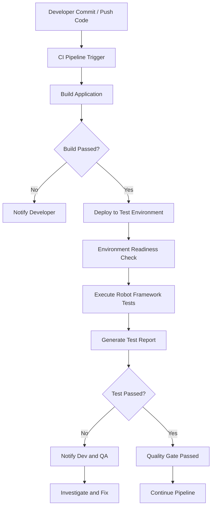
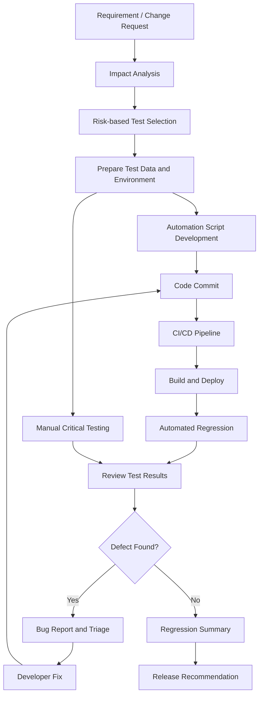

# Scenario 3 — Team Management & Regression Optimization

## 1. เป้าหมายและแนวทางการทำงาน

โจทย์ของบริษัทคือต้องการลดเวลาการทำ Regression Test จากเดิม 2 วัน ให้เหลือ 4 ชั่วโมง โดยมีทีม QA ทั้งหมด 3 คน

สำหรับแทน สิ่งแรกที่จะทำไม่ใช่การนำ Test Case ทั้งหมดไปทำ Automation ทันที แต่จะเริ่มจากการวิเคราะห์ชุด Regression Test เดิมก่อนว่า

- มี Test Case ทั้งหมดกี่รายการ
- Test Case ไหนมีความสำคัญต่อ Business มากที่สุด
- Test Case ไหนใช้เวลาทดสอบนาน
- Test Case ไหนมีการทดสอบซ้ำซ้อน
- Test Case ไหนเหมาะกับ Automation
- Test Case ไหนยังจำเป็นต้องใช้ Manual Testing

เป้าหมายคือทำให้ทีมสามารถทดสอบได้เร็วขึ้น โดยยังรักษาความครอบคลุมและคุณภาพของระบบไว้

### 1.1 เป้าหมายหลัก

| Area | เป้าหมาย |
|---|---|
| Regression Time | ลดจาก 2 วัน เหลือไม่เกิน 4 ชั่วโมง |
| Test Coverage | ครอบคลุม Critical Business Flow |
| Automation | ลดงาน Manual ที่ต้องทำซ้ำ |
| CI/CD Integration | ให้ Automation ทำงานอัตโนมัติตาม Code Change |
| Test Quality | ตรวจพบ Defect ก่อน Release |
| Team Development | พัฒนาทักษะ Automation ให้ทีมทำงานร่วมกันได้ |
| Maintainability | มี Test Script ที่ดูแลและแก้ไขต่อได้ง่าย |

หมายเหตุ: เป้าหมาย 4 ชั่วโมงจะใช้เป็น Target หลังจากประเมินจำนวน Test Case, Execution Time, Environment และความพร้อมของ Automation แล้ว

---

## 2. Team Structure & Delegation

ทีมมีสมาชิก 3 คน ได้แก่

1. Head Tester — แทน
2. QA Manual — น้อง QA คนปัจจุบัน
3. QA คนใหม่ — เข้ามาช่วยพัฒนาการทดสอบและ Automation

แทนจะไม่แบ่งงานโดยดูจากจำนวน Test Case เพียงอย่างเดียว แต่จะแบ่งตามความถนัด ประสบการณ์ และความรับผิดชอบของแต่ละคน

### 2.1 การแบ่งหน้าที่

| Role | Responsibility |
|---|---|
| Head Tester | วาง QA Strategy, วิเคราะห์ Risk, จัดลำดับ Regression Test, ออกแบบ Automation Framework, ประสาน DevOps, Review Script และติดตาม KPI |
| QA Manual | วิเคราะห์ Requirement, จัดทำ Test Scenario, ทดสอบ Critical Business Flow, Exploratory Testing และตรวจสอบผล Automation |
| QA คนใหม่ | เรียนรู้ระบบ, เตรียม Test Data, พัฒนา Automation Script ตาม Test Case ที่ได้รับมอบหมาย และดูแล Script |

แทนจะลงมือทำ Automation ในส่วนที่มีความซับซ้อนและเป็นโครงสร้างหลัก พร้อม Review งานของน้องทั้งสองคน

ส่วน QA Manual จะทำงานร่วมกับ QA คนใหม่ในรูปแบบ Pair Working เพื่อค่อย ๆ พัฒนาทักษะด้าน Automation Testing โดยเริ่มจากการออกแบบ Test Scenario การทำความเข้าใจ Keyword การอ่าน Test Script และการตรวจสอบผลการทดสอบ

วิธีนี้ช่วยให้ QA Manual สามารถต่อยอดทักษะจาก Manual Testing ไปสู่ Automation Testing ได้ โดยไม่จำเป็นต้องเปลี่ยนบทบาททั้งหมดในทันที

### 2.2 การทำงานร่วมกับทีมที่เกี่ยวข้อง

| Team | Responsibility |
|---|---|
| QA | กำหนด Test Scope, Test Scenario, Automation Script และ Quality Gate |
| Developer | จัดเตรียม Application Build, แก้ไข Defect และสนับสนุนการตรวจสอบระบบ |
| DevOps | จัดเตรียม CI/CD Pipeline, Runner และ Automation Execution Environment |
| Infrastructure | ดูแล Server, Network, Environment และ Resource ที่จำเป็น |
| Product / Business | ให้ข้อมูล Business Condition และยืนยัน Expected Result |

แทนจะทำหน้าที่เป็นผู้ประสานงานหลัก เพื่อให้ทุกทีมเข้าใจเป้าหมายและสามารถทำงานร่วมกันได้อย่างต่อเนื่อง

---

## 3. Regression Test Optimization

ก่อนลดเวลา Regression Test แทนจะจัดกลุ่ม Test Case ตามความเสี่ยงและความสำคัญของ Business

### 3.1 จัดกลุ่ม Test Case

| Priority | Test Scope | Testing Approach |
|---|---|---|
| P0 - Critical | Login, VPN Connection, Subscription, Payment และ Security ที่เกี่ยวข้อง | Automation + Manual Verification |
| P1 - High | ฟังก์ชันหลักที่ได้รับผลกระทบจาก Change | Automation เป็นหลัก |
| P2 - Medium | ฟังก์ชันรองและการทำงานร่วมกันระหว่าง Module | Automation ตามความเหมาะสม |
| P3 - Low | UI หรือฟังก์ชันที่มีความเสี่ยงต่ำ | Manual / Exploratory ตามความจำเป็น |

แทนจะไม่ตัด Test Case ที่มีความสำคัญออกเพียงเพื่อให้ได้เวลา 4 ชั่วโมง

แต่จะเลือกวิธีทดสอบให้เหมาะสมกับความเสี่ยง และใช้ Impact Analysis เพื่อเลือก Test Case ที่ต้องรันในแต่ละ Release

### 3.2 วิเคราะห์ Test Case สำหรับ Automation

แทนจะเลือก Test Case ที่มีลักษณะดังนี้มาทำ Automation ก่อน

- มีขั้นตอนการทดสอบซ้ำบ่อย
- Expected Result ชัดเจน
- มี Test Data ที่เตรียมได้
- เป็น Business Flow ที่สำคัญ
- มีขั้นตอนการทดสอบที่ค่อนข้างคงที่
- ใช้เวลาทดสอบ Manual ค่อนข้างนาน

ส่วน Test Case ที่ต้องใช้การสังเกต การตัดสินใจ หรือการประเมินประสบการณ์ผู้ใช้งาน จะยังคงใช้ Manual Testing

---

## 4. Automation Strategy

แทนจะเลือกใช้ Robot Framework เป็นเครื่องมือหลักในการทำ Automation Testing เนื่องจากสามารถเขียน Test Script ในรูปแบบ Keyword-driven ทำให้อ่านง่าย และสามารถแยก Test Case ออกจากส่วนที่ใช้ควบคุมการทำงานของระบบได้

### 4.1 โครงสร้าง Automation Framework

ตัวอย่างโครงสร้าง Project:

```text
automation/
│
├── tests/
│   ├── login.robot
│   ├── subscription.robot
│   ├── vpn_connection.robot
│   └── payment.robot
│
├── resources/
│   ├── common.resource
│   ├── login.resource
│   ├── subscription.resource
│   └── vpn.resource
│
├── testdata/
│   └── testdata.json
│
├── results/
│
└── README.md
```

โครงสร้างนี้ช่วยให้แยก Test Case, Reusable Keywords และ Test Data ออกจากกัน ทำให้ดูแลและแก้ไขได้ง่ายขึ้น

### 4.2 ตัวอย่าง Automation Test

ตัวอย่างการทดสอบ Login ด้วย Robot Framework

```robot
*** Settings ***
Library    SeleniumLibrary

*** Variables ***
${URL}         https://example.com
${USERNAME}    test_user
${PASSWORD}    test_password

*** Test Cases ***
Verify Successful Login
    Open Browser    ${URL}    Chrome
    Input Text      id=username    ${USERNAME}
    Input Password  id=password    ${PASSWORD}
    Click Button    id=login
    Wait Until Element Is Visible    id=dashboard
    Page Should Contain    Dashboard
    Close Browser
```

ตัวอย่างนี้เป็นเพียง Script จำลอง ต้องปรับ URL, Locator และ Test Data ให้ตรงกับระบบจริงก่อนใช้งาน

### 4.3 การแบ่ง Automation Coverage

แทนจะเริ่มจาก Critical Business Flow ก่อน เช่น

| Module | Automation Scenario |
|---|---|
| Login | Login Success / Invalid Credentials |
| Subscription | Free User / Premium User |
| Payment | Payment Success / Payment Failed |
| VPN Connection | Connect / Disconnect / Reconnect |
| Package | Package Mapping / Entitlement |
| Regression | ตรวจสอบฟังก์ชันหลักหลังมีการเปลี่ยนแปลง |

เมื่อ Automation มีความเสถียรแล้ว จึงค่อยขยาย Coverage ไปยัง Module อื่น

### 4.4 Cross-browser Testing

สำหรับระบบที่รองรับหลาย Browser แทนจะใช้ Robot Framework ร่วมกับ SeleniumLibrary และกำหนด Browser ที่ต้องทดสอบตาม Browser Support Matrix ของผลิตภัณฑ์

โดยจะเลือก Critical Flow มาทดสอบบน Browser ที่มีความสำคัญก่อน ไม่จำเป็นต้องรันทุก Test Case บนทุก Browser ทุกครั้ง หากไม่มีความเสี่ยงหรือการเปลี่ยนแปลงที่เกี่ยวข้อง

---

## 5. Test Environment & CI/CD Integration

สำหรับแทน การทำ Automation ไม่ควรจบแค่การเขียน Test Script แล้วรอให้ QA มากด Run เองทุกครั้ง

เป้าหมายคือการสร้าง Automated Testing Pipeline ที่เชื่อมต่อกับกระบวนการพัฒนา Software เพื่อให้ระบบสามารถ Build และ Execute Automation Test ได้โดยอัตโนมัติเมื่อมี Code Change

แทนจะประสานงานกับ Developer, DevOps และ Infrastructure เพื่อเตรียม Environment และกำหนดขั้นตอนการทำงานร่วมกัน

### 5.1 การเตรียม Test Environment

ก่อนนำ Automation ไปเชื่อมต่อกับ CI/CD Pipeline ต้องเตรียม Environment ให้พร้อมใช้งานก่อน

สิ่งที่ต้องดำเนินการร่วมกับทีมที่เกี่ยวข้อง ได้แก่

**1. Test Environment**

- เตรียม Environment สำหรับ Automation โดยเฉพาะ
- ตรวจสอบการเชื่อมต่อระหว่าง Application, Database และ Service ที่เกี่ยวข้อง
- กำหนด Configuration ให้เหมาะสมกับการทดสอบ
- แยก Test Data ออกจากข้อมูล Production
- เตรียมบัญชีทดสอบและสิทธิ์การเข้าถึงระบบ
- กำหนดวิธี Reset หรือ Cleanup Test Data หลังการทดสอบ

**2. Automation Infrastructure**

- เตรียมเครื่องหรือ Runner สำหรับ Execute Automation Test
- ติดตั้ง Robot Framework และ Library ที่จำเป็น
- เตรียม Browser และ WebDriver
- จัดการ Environment Variables และ Credentials อย่างปลอดภัย
- เตรียมพื้นที่เก็บ Test Report, Log และ Screenshot
- พิจารณา Parallel Execution หาก Infrastructure รองรับ

**3. การทำงานร่วมกับ Developer และ DevOps**

- ตกลงขั้นตอนการ Build และ Deploy Application
- กำหนด Environment ที่ Automation จะเข้าไปทดสอบ
- กำหนด URL, Configuration และ Test Data
- กำหนด Trigger สำหรับเรียก Automation
- กำหนดเงื่อนไข Pass / Fail ของแต่ละ Pipeline
- กำหนดช่องทางแจ้งผลการทดสอบให้ทีมที่เกี่ยวข้อง

### 5.2 Automated Testing Pipeline

แทนจะประสานทีม DevOps เพื่อเชื่อมต่อ Robot Framework เข้ากับ CI/CD Platform ที่บริษัทใช้อยู่ เช่น GitHub Actions, Jenkins หรือ GitLab CI/CD

แนวทางการทำงาน:

1. Developer Commit หรือ Push Code เข้ามาใน Repository
2. CI/CD Pipeline Trigger โดยอัตโนมัติ
3. ระบบ Build Application
4. หาก Build ผ่าน ระบบ Deploy ไปยัง Test Environment ตามขั้นตอน
5. ตรวจสอบความพร้อมของ Environment
6. Execute Automation Test ตาม Test Scope ที่กำหนด
7. สร้าง Test Report และเก็บ Log
8. แจ้งผลการทดสอบให้ Developer และ QA
9. หาก Test ผ่าน จึงดำเนินการใน Pipeline ขั้นตอนถัดไป
10. หาก Test ไม่ผ่าน ให้ตรวจสอบสาเหตุและแก้ไขก่อนดำเนินการต่อ

### 5.3 ตัวอย่าง CI/CD Pipeline



### 5.4 การแบ่งระดับ Automation ตาม CI/CD Workflow

แทนจะไม่กำหนดให้ Full Regression ทำงานทุกครั้งที่มี Code Commit เพราะอาจทำให้ Pipeline ใช้เวลานานเกินไป

จึงจะแบ่งชุดทดสอบตามจังหวะการทำงาน ดังนี้

| Pipeline Trigger | Test Scope | Purpose |
|---|---|---|
| ทุกครั้งที่ Commit / Push | Build Validation + Fast Smoke Test | ตรวจสอบเบื้องต้นว่า Code และฟังก์ชันหลักยังทำงานได้ |
| เมื่อสร้าง Pull Request | Smoke Test + API Test + Impact-based Test | ตรวจสอบก่อน Merge Code |
| หลัง Merge เข้า Main Branch | Integration Test + Regression Test ที่เกี่ยวข้อง | ตรวจสอบผลกระทบจาก Code Change |
| ก่อน Release | Full Regression Test + Manual Critical Verification | ตรวจสอบความพร้อมก่อน Release |

แนวทางนี้ช่วยให้ Developer ได้รับ Feedback อย่างรวดเร็ว โดยไม่ต้องรอให้ QA สั่งรัน Automation เองทุกครั้ง

หากพบ Test Failure ระบบจะแจ้งผลพร้อม Test Report และ Log ให้ทีมที่เกี่ยวข้องตรวจสอบ

ทั้งนี้ การกำหนด Quality Gate ต้องพิจารณาประเภทของ Test, ความเสถียรของ Environment และผลกระทบของ Defect เพื่อไม่ให้เกิดการ Block Pipeline จาก Flaky Test โดยไม่จำเป็น

### 5.5 เครื่องมือที่สามารถนำมาใช้

| Tool | Purpose |
|---|---|
| Robot Framework | Automation Test Execution |
| SeleniumLibrary | Browser Automation |
| GitHub Actions | CI/CD Pipeline |
| Jenkins | CI/CD Automation |
| GitLab CI/CD | CI/CD Pipeline |
| Docker | จัดเตรียม Test Execution Environment |

เครื่องมือที่จะเลือกใช้จริงขึ้นอยู่กับ Technology Stack และ CI/CD Platform ที่บริษัทใช้อยู่ เพื่อให้สามารถทำงานร่วมกับระบบเดิมได้โดยไม่สร้างความซับซ้อนเพิ่ม

### 5.6 บทบาทของ Head Tester ใน CI/CD

แทนจะรับผิดชอบด้าน QA Strategy และ Test Automation ได้แก่

- กำหนด Test Scope และ Test Scenario สำหรับแต่ละ Pipeline
- กำหนดเกณฑ์ Pass / Fail และ Quality Gate
- ประสาน DevOps เพื่อเตรียม Automation Infrastructure
- ประสาน Developer เพื่อเตรียม Test Environment และ Test Data
- Review Automation Script และ Test Report
- วิเคราะห์ Flaky Test และ False Failure
- ติดตามผลการทดสอบและปรับปรุง Pipeline อย่างต่อเนื่อง

เป้าหมายคือทำให้ Automation เป็นส่วนหนึ่งของ Development Process ไม่ใช่งานที่ QA ต้องมารันเองหลังจาก Developer ส่งงานเสร็จแล้ว

---

## 6. Workflow การทำงานของทีม

แทนจะจัด Workflow ให้ทุกคนทำงานต่อเนื่องกัน โดยมีการตรวจสอบและส่งต่องานอย่างชัดเจน



### 6.1 หน้าที่ในแต่ละขั้นตอน

| Workflow | Owner |
|---|---|
| Impact Analysis | Head Tester |
| Risk-based Test Selection | Head Tester + QA Manual |
| Test Scenario Design | QA Manual |
| Test Data Preparation | QA คนใหม่ + Developer |
| Automation Development | Head Tester + QA คนใหม่ |
| Manual Testing | QA Manual |
| CI/CD Pipeline Setup | DevOps + Head Tester |
| Test Environment Preparation | DevOps + Infrastructure + QA |
| Script Review | Head Tester |
| Defect Investigation | QA ทั้งทีม |
| Test Result Summary | Head Tester |
| Release Recommendation | Head Tester |

แม้จะแบ่งหน้าที่ชัดเจน แต่ทุกคนต้องสามารถช่วยตรวจสอบและทำงานแทนกันได้ในกรณีจำเป็น เพื่อไม่ให้ความรู้ของระบบอยู่กับคนใดคนหนึ่งเพียงคนเดียว

---

## 7. แผนลด Regression Test จาก 2 วัน เหลือ 4 ชั่วโมง

แทนจะไม่เปลี่ยนทุกอย่างในครั้งเดียว แต่จะแบ่งการดำเนินงานเป็นระยะ เพื่อให้ทีมมีเวลาปรับตัวและตรวจสอบคุณภาพของ Automation

### Phase 1 — Assessment

ระยะเวลา: สัปดาห์ที่ 1

- รวบรวม Regression Test Case ทั้งหมด
- วิเคราะห์ Test Execution Time
- จัดกลุ่ม Test Case ตาม Risk และ Priority
- ตรวจสอบ Test Case ที่ซ้ำซ้อน
- เลือก Test Case สำหรับทำ Automation
- ตรวจสอบ Test Environment และ Test Data
- ประสาน DevOps และ Developer เพื่อประเมิน CI/CD Readiness

ผลลัพธ์: Regression Test Inventory และ Automation Backlog

### Phase 2 — Automation Foundation

ระยะเวลา: สัปดาห์ที่ 2

- เตรียม Robot Framework
- วางโครงสร้าง Automation Framework
- สร้าง Common Keywords
- เตรียม Test Data
- เตรียม Automation Runner และ Test Environment
- สร้าง Automation Script สำหรับ Critical Flow
- ประสาน DevOps เพื่อเตรียม CI/CD Pipeline
- Review Script และตรวจสอบความเสถียร

ผลลัพธ์: Automation Framework, Test Environment และชุด Test Script เริ่มต้น

### Phase 3 — Automation & CI/CD Integration

ระยะเวลา: สัปดาห์ที่ 3

- เพิ่ม Automation Test Case ตาม Priority
- เชื่อมต่อ Robot Framework กับ CI/CD Pipeline
- ตั้ง Trigger เมื่อมี Code Commit หรือ Pull Request
- ทดสอบขั้นตอน Build, Deploy และ Test Execution
- ทดลองรัน Automation ร่วมกับ Manual Testing
- ตั้งค่าการจัดเก็บ Test Report และ Log
- เก็บ Execution Time และ Defect Result

ผลลัพธ์: Automated Testing Pipeline ที่สามารถเรียกใช้ Automation ได้โดยอัตโนมัติ

### Phase 4 — Optimization

ระยะเวลา: สัปดาห์ที่ 4

- ปรับปรุง Execution Time
- ลด Flaky Test
- ปรับปรุง Test Data Management
- ปรับปรุง CI/CD Pipeline
- ทดลอง Parallel Execution หากระบบและ Environment รองรับ
- วัดผล Regression Execution Time
- ประเมินความพร้อมในการใช้ Target 4 ชั่วโมง

ผลลัพธ์: Regression Process ที่มีความเสถียรและสามารถวัดผลได้

ระยะเวลาแต่ละ Phase เป็นแผนเบื้องต้น ต้องปรับตามจำนวน Test Case ความซับซ้อนของระบบ และความพร้อมของทีมที่เกี่ยวข้อง

---

## 8. ตัวอย่างการจัดสรรเวลา 4 ชั่วโมง

เมื่อ Automation Suite มีความเสถียรแล้ว แทนจะกำหนดกรอบเวลาสำหรับ Full Regression Cycle ดังนี้

| Activity | Target Time |
|---|---:|
| Environment / Test Data Readiness | 15 นาที |
| Automation Regression Execution | 105 นาที |
| Manual Critical Flow Verification | 45 นาที |
| Defect Review / Retest | 45 นาที |
| Test Summary | 30 นาที |
| **Total** | **240 นาที (4 ชั่วโมง)** |

เวลาข้างต้นเป็นเป้าหมายในการวางแผน ไม่ใช่ผลการทดสอบที่ยืนยันแล้ว

ส่วน Fast Smoke Test ที่ทำงานทุกครั้งเมื่อมี Code Commit จะเป็นชุดทดสอบแยกต่างหาก และไม่จำเป็นต้องรัน Full Regression ซ้ำทุกครั้ง

หากพบ Defect ที่ต้องใช้เวลาแก้ไขเกินกรอบที่กำหนด แทนจะรายงานสถานะและผลกระทบตามจริง ไม่ลดขั้นตอนการทดสอบเพื่อให้ตัวเลขเวลาผ่านเป้าหมาย

---

## 9. Team Development & Knowledge Sharing

แทนให้ความสำคัญกับการพัฒนาทักษะของทีมควบคู่กับการทำงานจริง

### QA Manual

- เรียนรู้พื้นฐาน Robot Framework
- เข้าใจ Keyword และ Test Structure
- ฝึกวิเคราะห์ Test Scenario สำหรับ Automation
- Pair Working กับ QA คนใหม่
- เรียนรู้การอ่าน Automation Report
- ช่วยตรวจสอบผลการทดสอบและวิเคราะห์ Defect

### QA คนใหม่

- เรียนรู้ Product และ Business Flow
- เรียนรู้ Robot Framework
- ฝึกเขียน Automation Script
- เรียนรู้การเตรียม Test Data
- ฝึก Debug และแก้ไข Script
- เรียนรู้การทำ Regression Testing
- เรียนรู้การทำงานร่วมกับ CI/CD Pipeline

### Head Tester

- วาง Automation Strategy
- ออกแบบ Framework
- Review Test Script
- ให้คำแนะนำด้าน Technical Testing
- ประสานงานกับ DevOps และ Developer
- กำหนด Automation Quality Gate
- ติดตาม Skill Development
- ถ่ายทอดความรู้ให้ทีมสามารถดูแลระบบร่วมกันได้

แทนจะจัด Knowledge Sharing และ Code Review เป็นประจำ เพื่อให้ทุกคนเข้าใจโครงสร้าง Automation Framework เดียวกัน

เป้าหมายคือไม่ให้งาน Automation กลายเป็นความรับผิดชอบของคนใดคนหนึ่งเพียงคนเดียว

---

## 10. Quality Metrics & KPI

แทนจะติดตามผลทั้งด้านเวลา คุณภาพ Automation และประสิทธิภาพของ CI/CD Pipeline

| Metric | Measurement | Target |
|---|---|---|
| Regression Execution Time | เวลารวมในการทำ Full Regression | ไม่เกิน 4 ชั่วโมง |
| Automation Coverage | สัดส่วน Test Case ที่ทำ Automation | เพิ่มขึ้นตามแผน |
| Automation Pass Rate | สัดส่วน Script ที่ผ่านการรัน | ติดตามตาม Baseline |
| Pipeline Automation Rate | สัดส่วนขั้นตอนที่ทำงานอัตโนมัติ | เพิ่มขึ้นตามแผน |
| Pipeline Success Rate | ความสำเร็จของ Pipeline | ติดตามและปรับปรุง |
| Pipeline Feedback Time | เวลาตั้งแต่ Code Change จนได้รับผล Smoke Test | อยู่ในกรอบที่กำหนด |
| Flaky Test Rate | สัดส่วน Script ที่ผลไม่คงที่ | ลดลงอย่างต่อเนื่อง |
| Test Report Availability | ความพร้อมของ Test Report หลังรัน | มี Report ทุกครั้ง |
| Defect Detection | จำนวน Defect ที่พบก่อน Release | ติดตามแนวโน้ม |
| Defect Leakage | Defect ที่หลุดไป Production | ลดลง |
| Script Maintenance | เวลาในการแก้ไขและดูแล Script | ลดลง |
| Team Skill Development | ความสามารถในการสร้างและดูแล Script | สมาชิกสามารถทำงานร่วมกันได้ |

แทนจะเก็บ Baseline ก่อนกำหนด Target ของ Metrics ที่ยังไม่มีข้อมูล เพื่อให้เป้าหมายเหมาะสมกับสภาพการทำงานจริง

---

## Conclusion

สำหรับแทน การลดเวลา Regression Test จาก 2 วันเหลือ 4 ชั่วโมง ไม่ใช่เพียงการทำ Automation ให้ได้มากที่สุด

แต่เป็นการปรับกระบวนการทำงานทั้งระบบ ตั้งแต่การเลือก Test Case การจัดลำดับความเสี่ยง การแบ่งงาน การเตรียม Test Environment การพัฒนา Automation ไปจนถึงการเชื่อมต่อ CI/CD Pipeline

สิ่งที่แทนต้องการคือ เมื่อ Developer มีการ Commit Code ระบบสามารถ Build และเรียก Automation Test ทำงานได้โดยอัตโนมัติ ทำให้ทีมได้รับ Feedback อย่างรวดเร็ว โดยไม่ต้องรอให้ QA มาสั่งรันเองทุกครั้ง

ในฐานะ Head Tester แทนจะไม่ทำทุกอย่างด้วยตัวเอง แต่จะสร้างระบบการทำงานร่วมกันระหว่าง QA, Developer และ DevOps เพื่อให้ทุกคนมีส่วนร่วมในการรักษาคุณภาพของ Software ตั้งแต่ขั้นตอนการพัฒนา

สิ่งที่อยากเห็นไม่ใช่แค่ทีมที่ทดสอบได้เร็วขึ้น แต่เป็นทีม QA ที่มีทักษะมากขึ้น ทำงานได้อย่างเป็นระบบ และมี Quality Process ที่ทำงานต่อเนื่องไปพร้อมกับ Development Lifecycle ค่ะ
